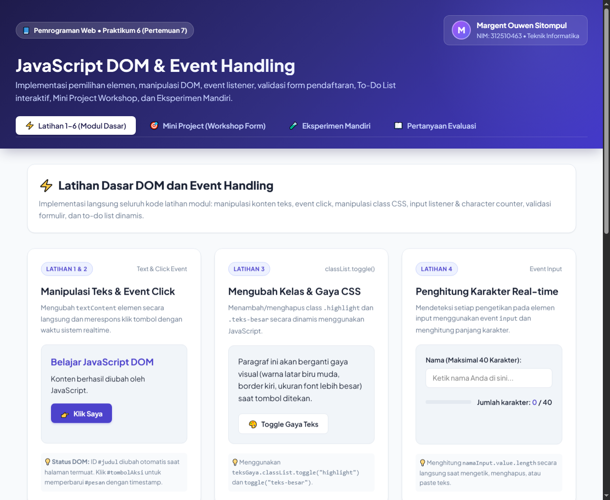
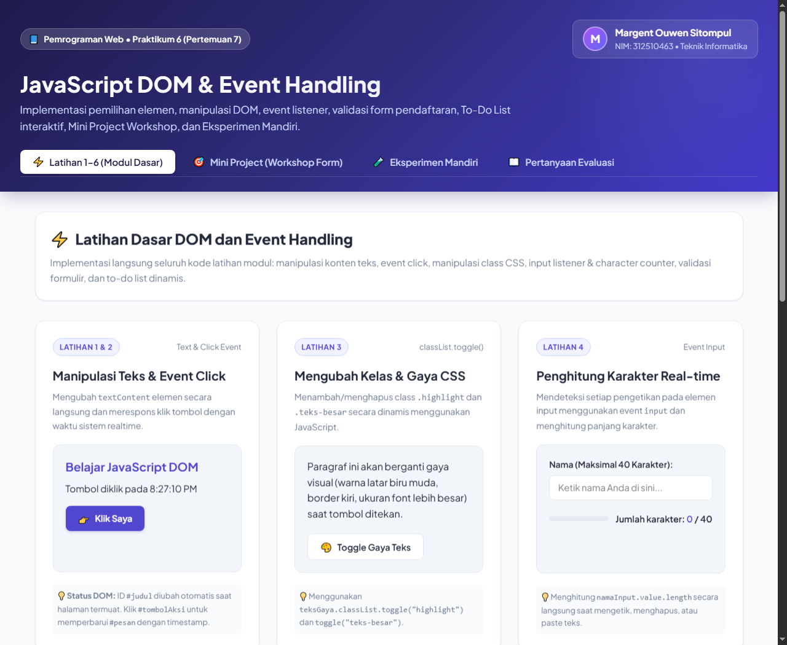
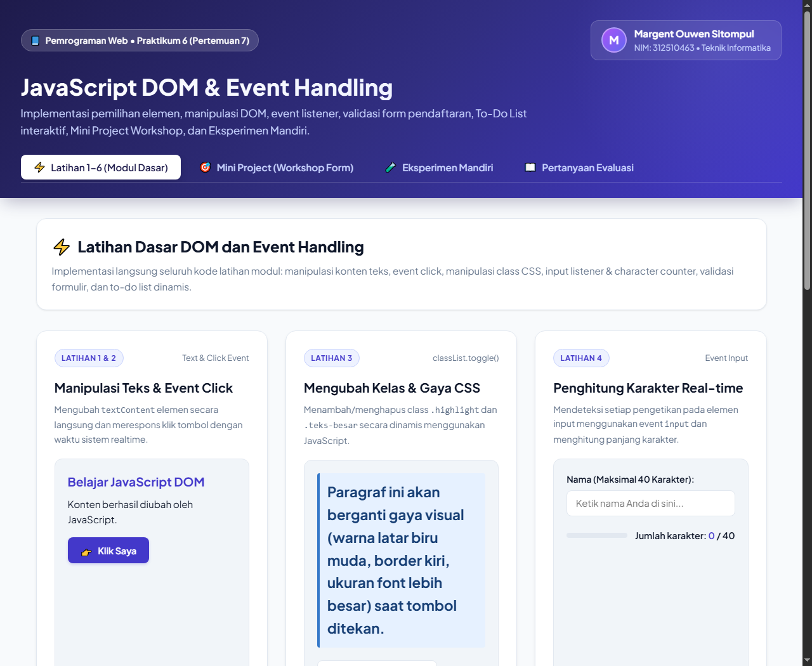
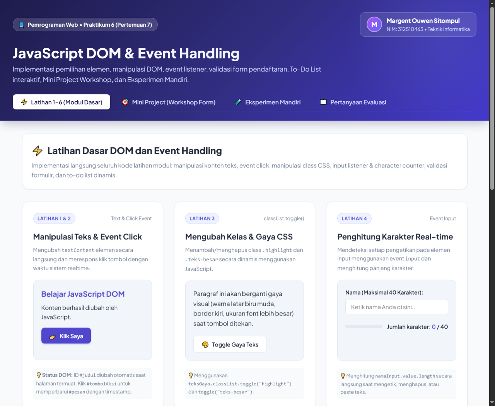
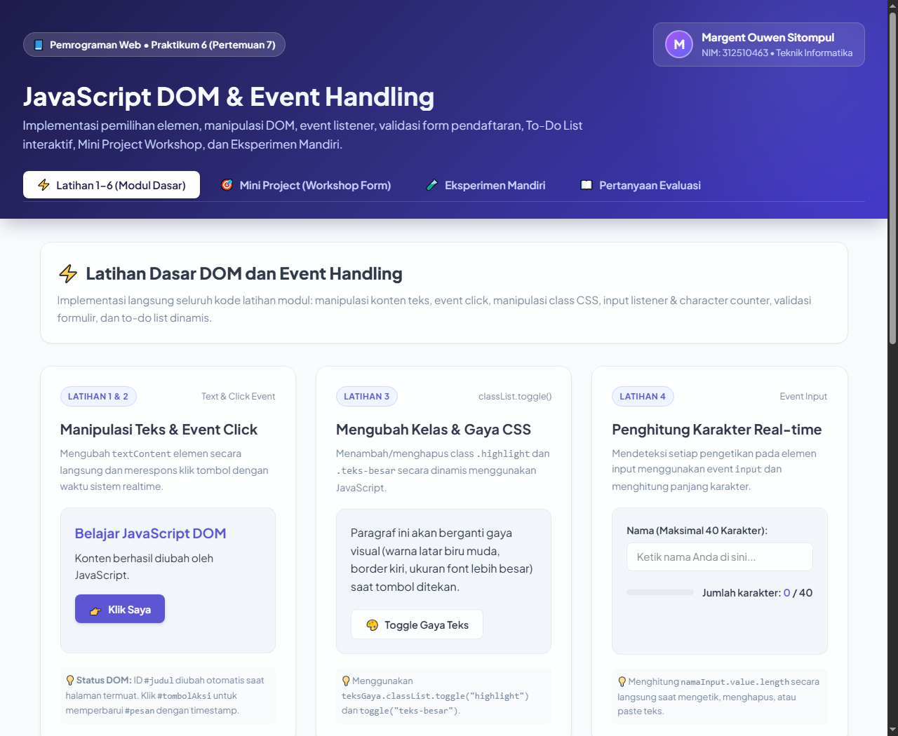
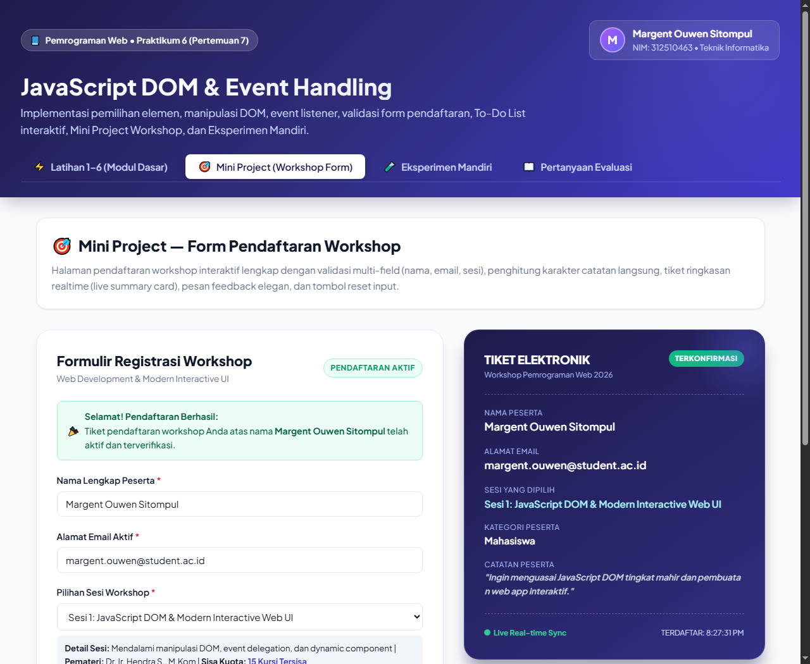
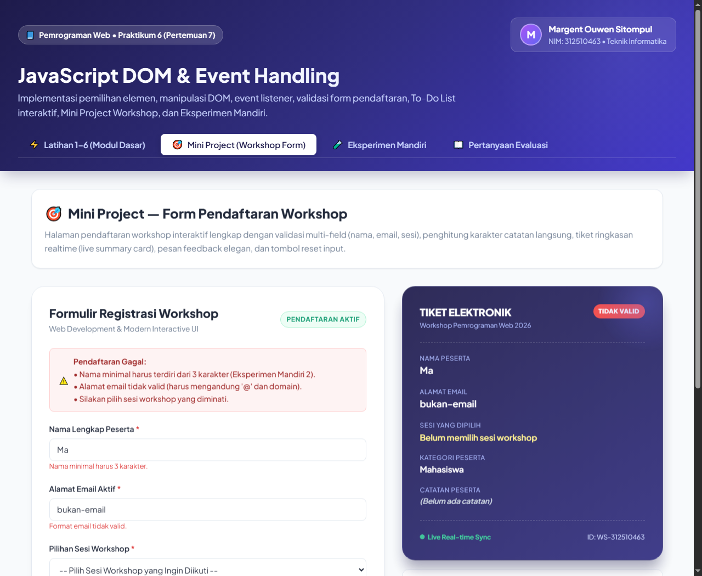
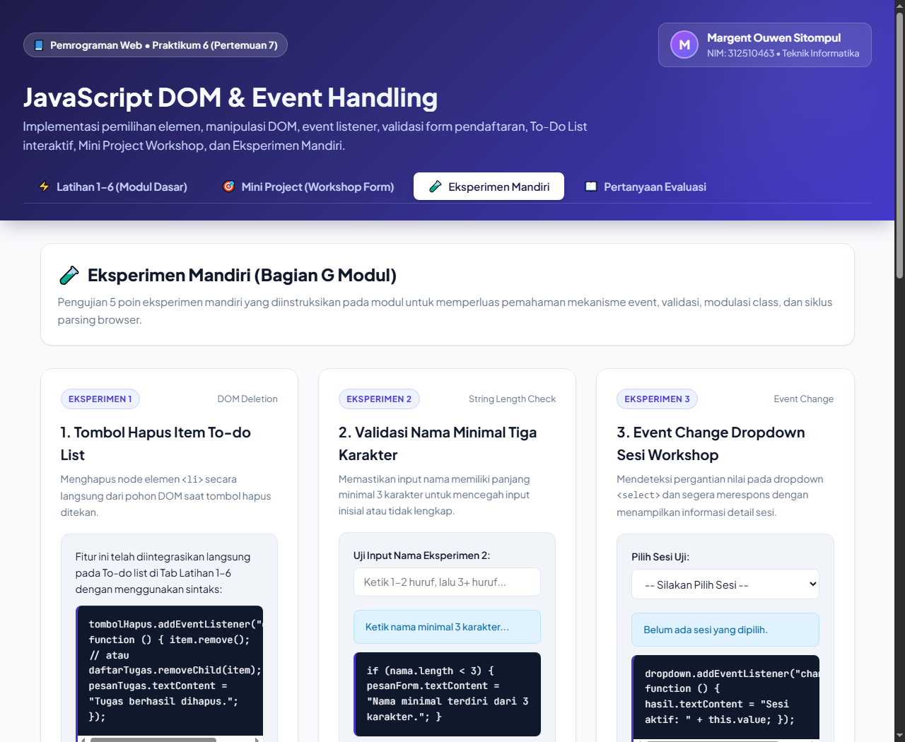
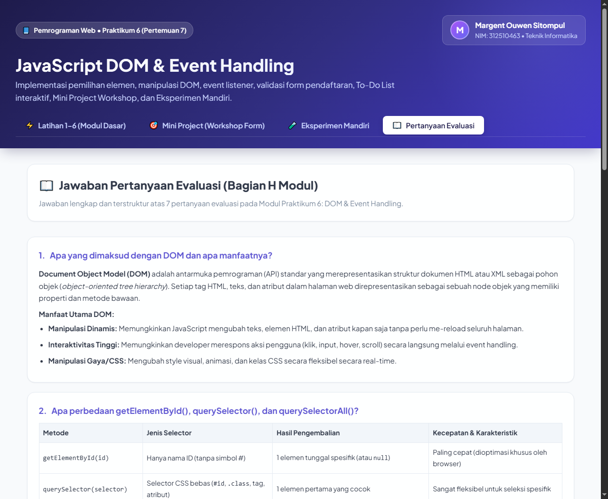

# Praktikum 6: JavaScript DOM dan Event Handling
**Mata Kuliah:** Pemrograman Web (Pertemuan 7)  
**Program Studi:** Teknik Informatika • Kurikulum OBE  
**Repository:** `Lab6Web`

---

## 👤 Identitas Praktikan
* **Nama Lengkap:** Margent Ouwen Sitompul
* **NIM:** 312510463
* **Kelas:** Teknik Informatika
* **Topik Praktikum:** Pemilihan & manipulasi elemen DOM, event handling, validasi form, To-Do list, dan Mini Project Workshop

---

## 🎯 Tujuan Praktikum
1. Memahami konsep **Document Object Model (DOM)** sebagai representasi pohon objek dokumen HTML yang dapat dimanipulasi secara programatis dengan JavaScript.
2. Menggunakan `id`, `class`, dan selector CSS untuk memilih elemen HTML dengan `getElementById()`, `querySelector()`, dan `querySelectorAll()`.
3. Mengubah teks (`textContent`), atribut (`setAttribute`), kelas CSS (`classList.toggle`), dan gaya tampilan elemen melalui JavaScript.
4. Menangani event aksi interaksi pengguna menggunakan `addEventListener()` (event `click`, `input`, `change`, `submit`).
5. Membuat validasi formulir sisi klien (client-side validation) dan menampilkan pesan sesuai kondisi masukan pengguna.
6. Mengembangkan aplikasi web interaktif (*Mini Project Workshop Registration*) dengan antarmuka modern yang responsif di desktop maupun mobile.

---

## 📁 Struktur File Repository
```text
Lab6Web/
├── index.html                   # Dashboard aplikasi web interaktif utama
├── style.css                    # Styling CSS modern, responsif, dan kelas modul praktikum
├── script.js                    # Logika manipulasi DOM, event listener, dan validasi
├── laporan.html                 # Dokumen HTML sumber cetak laporan resmi
├── Laporan_Praktikum6_312510463_Margent_Ouwen_Sitompul.pdf  # Dokumen laporan resmi berformat PDF
├── lab6_dom_event/              # Direktori standalone modul latihan
│   ├── index.html
│   ├── style.css
│   └── script.js
├── screenshots/                 # Berkas tangkapan layar bukti pengujian praktikum
│   ├── overview_dashboard.png
│   ├── latihan1_2_teks_click.png
│   ├── latihan3_toggle_style.png
│   ├── latihan4_input_counter.png
│   ├── latihan5_form_invalid.png
│   ├── latihan5_form_valid.png
│   ├── latihan6_todo_list.png
│   ├── miniproject_workshop_valid.png
│   ├── miniproject_workshop_invalid.png
│   ├── eksperimen_mandiri.png
│   └── pertanyaan_evaluasi.png
└── README.md                    # Dokumentasi lengkap proyek
```

---

## 🚀 Cara Menjalankan Aplikasi
Aplikasi ini dibangun menggunakan **Vanilla HTML5, CSS3, dan Modern JavaScript** tanpa ketergantungan *build tools* eksternal. Anda dapat menjalankannya dengan salah satu cara berikut:

### Opsi 1: Langsung Buka di Browser
Klik dua kali berkas [`index.html`](file:///c:/Users/user/Lab6Web/index.html) untuk langsung membukanya di browser Google Chrome, Edge, atau Firefox.

### Opsi 2: Menggunakan Local Web Server
Buka terminal pada direktori `Lab6Web` dan jalankan salah satu perintah:
```bash
# Menggunakan Python
python -m http.server 8080

# Atau menggunakan Node.js (npx serve / live-server)
npx serve .
```
Lalu buka alamat [http://localhost:8080](http://localhost:8080) pada browser.

---

## 🛠️ Langkah Kerja & Rincian Implementasi

### 1. Latihan 1: Mengubah Teks dengan DOM
* **Elemen:** `#judul` dan `#pesan`
* **Implementasi:** Menggunakan properti `textContent` untuk memperbarui teks secara aman tanpa parsing HTML.
```javascript
const judul = document.getElementById("judul");
const pesan = document.getElementById("pesan");
judul.textContent = "Belajar JavaScript DOM";
pesan.textContent = "Konten berhasil diubah oleh JavaScript.";
```

### 2. Latihan 2: Event Click
* **Elemen:** `#tombolAksi` dan `#pesan`
* **Implementasi:** Memasang `addEventListener("click", ...)` untuk mengubah konten `#pesan` menjadi waktu lokal sistem saat tombol diklik.
```javascript
tombol.addEventListener("click", function () {
  pesan.textContent = "Tombol diklik pada " + new Date().toLocaleTimeString();
});
```

### 3. Latihan 3: Mengubah Kelas dan Gaya CSS
* **Elemen:** `#tombolGaya`, `#teksGaya`, kelas `.highlight`, dan `.teks-besar`
* **Implementasi:** Menggunakan `classList.toggle()` untuk mengaktifkan atau menonaktifkan gaya CSS secara bergantian.
```javascript
tombolGaya.addEventListener("click", function () {
  teksGaya.classList.toggle("highlight");
  teksGaya.classList.toggle("teks-besar");
});
```

### 4. Latihan 4: Event Input dan Penghitung Karakter
* **Elemen:** `#namaInput` dan `#jumlahKarakter`
* **Implementasi:** Memantau perubahan teks secara real-time via event `input` dan membaca panjang teks dari `namaInput.value.length`.
```javascript
namaInput.addEventListener("input", function () {
  jumlahKarakter.textContent = namaInput.value.length;
});
```

### 5. Latihan 5: Validasi Form Pendaftaran
* **Elemen:** `#formPendaftaran`, `#nama`, `#email`, `#usia`, `#pesanForm`
* **Implementasi:**
  1. `event.preventDefault()` untuk mencegah reload halaman.
  2. Pengecekan nama tidak boleh kosong (`nama === ""`).
  3. Pengecekan format email menggunakan Regular Expression: `/^[^\s@]+@[^\s@]+\.[^\s@]+$/`.
  4. Pengecekan usia berupa bilangan bulat dalam rentang 17 hingga 100 tahun (`Number.isInteger(usia)` dan `usia >= 17 && usia <= 100`).
  5. Jika lolos seluruh validasi, memunculkan pesan sukses dan mengeksekusi `form.reset()`.

### 6. Latihan 6: Daftar Tugas Sederhana (To-Do List Dinamis)
* **Elemen:** `#inputTugas`, `#tambahTugas`, `#daftarTugas`, `#pesanTugas`
* **Implementasi:**
  1. Memvalidasi agar teks tugas tidak kosong.
  2. Membuat elemen dinamis menggunakan `document.createElement("li")`, `createElement("span")`, dan `createElement("button")`.
  3. Memasang tombol *"Tandai selesai"* yang melakukan toggle class `.selesai` (efek coret *line-through*).
  4. Menambahkan tombol *"Hapus"* (Eksperimen Mandiri 1) untuk menghapus elemen tugas dari list via `item.remove()`.

---

## 🎯 Mini Project — Form Pendaftaran Workshop
Halaman registrasi workshop interaktif yang dilengkapi:
1. **Validasi Multi-field:** Validasi nama lengkap (minimal 3 karakter), alamat email berformat benar, dan pilihan sesi workshop wajib ditentukan.
2. **Live Preview Tiket Realtime:** Kartu tiket digital yang ter-sinkronisasi langsung dengan apa yang diketikkan dan dipilih peserta.
3. **Penghitung Karakter Catatan:** Pemantauan batas panjang catatan peserta (maksimal 150 karakter).
4. **Alert Peringatan & Konfirmasi:** Komponen visual umpan balik yang informatif.
5. **Tombol Reset:** Mengembalikan isian formulir dan tiket ke status draft awal.

---

## 🧪 Eksperimen Mandiri (Bagian G Modul)
1. **Tombol Hapus Item To-do List:** Diimplementasikan dengan menambahkan tombol hapus pada setiap item list dan memanggil `item.remove()`.
2. **Validasi Nama Minimal 3 Karakter:** Menambahkan kondisi `if (nama.length < 3)` pada submit listener dan input handler.
3. **Event Change Dropdown Sesi Workshop:** Memasang listener `change` pada `<select>` untuk mendeteksi sesi yang dipilih dan memperbarui deskripsi, kuota, serta nama pembicara secara otomatis.
4. **Sembunyikan / Tampilkan Paragraf via Class CSS:** Menggunakan class `.hidden-element { display: none !important; }` dan tombol toggle dengan `classList.toggle("hidden-element")`.
5. **Analisis Script di `<head>` Tanpa Defer:**
   * Jika `<script>` ditaruh di `<head>` tanpa `defer`, browser mengeksekusinya sebelum elemen HTML di dalam `<body>` dibuat.
   * Pemanggilan `document.getElementById(...)` menghasilkan nilai `null`.
   * Saat mengakses properti seperti `judul.textContent`, browser akan melempar error: `Uncaught TypeError: Cannot set properties of null`.
   * Solusinya adalah menyertakan atribut `defer` atau membungkus skrip dalam event `DOMContentLoaded`.

---

## 📖 Jawaban Pertanyaan Evaluasi (Bagian H Modul)
1. **Pengertian dan Manfaat DOM:**  
   DOM adalah representasi dokumen HTML dalam bentuk pohon objek hierarkis standar W3C. Manfaatnya memungkinkan bahasa skrip seperti JavaScript untuk menambah, mengubah, dan menghapus elemen, atribut, serta gaya tampilan secara dinamis tanpa me-reload dokumen.
2. **Perbedaan `getElementById()`, `querySelector()`, dan `querySelectorAll()`:**  
   * `getElementById(id)`: Menerima string ID murni dan mengembalikan 1 elemen spesifik; memiliki eksekusi tercepat.
   * `querySelector(sel)`: Menerima sembarang selector CSS dan mengembalikan 1 elemen pertama yang cocok.
   * `querySelectorAll(sel)`: Menerima selector CSS dan mengembalikan seluruh elemen yang cocok dalam bentuk `NodeList` statis.
3. **Fungsi `addEventListener()` dan Tiga Contoh Event:**  
   Fungsinya untuk meregistrasikan fungsi penangan (callback) pada elemen untuk tipe kejadian tertentu tanpa saling menimpa handler lain. Contoh event: `click`, `input`, `submit`.
4. **Alasan Penggunaan `event.preventDefault()` pada Submit Form:**  
   Untuk menghentikan aksi bawaan browser yang me-refresh atau mengarahkan halaman ke URL target, sehingga proses validasi client-side dapat dijalankan sepenuhnya oleh JavaScript.
5. **Perbedaan `textContent` dan `innerHTML`:**  
   `textContent` menyisipkan teks biasa tanpa mem-parse tag HTML dan aman dari kerentanan Cross-Site Scripting (XSS). `innerHTML` mem-parse string menjadi markup HTML nyata namun berisiko tinggi terhadap injeksi kode berbahaya jika bersumber dari input pengguna.
6. **Peran `classList.toggle()`:**  
   Berfungsi seperti sakelar (toggle switch) yang otomatis menambahkan kelas CSS jika belum ada, atau menghapusnya jika sudah ada pada elemen, menyederhanakan kode kondisional visual.
7. **Tiga Skenario Pengujian Validasi Form:**  
   * Skenario 1: Semua field kosong (submit ditolak: *"Nama wajib diisi."*).
   * Skenario 2: Format email tidak valid tanpa '@' atau domain (submit ditolak: *"Masukkan email yang valid."*).
   * Skenario 3: Usia di bawah 17 tahun atau desimal (submit ditolak: *"Usia harus berupa bilangan bulat 17–100."*).

---

## 📸 Dokumentasi Tangkapan Layar (Screenshots)

### 1. Dashboard Utama & Header


### 2. Latihan 1 & 2: Manipulasi Teks & Event Click


### 3. Latihan 3: Mengubah Kelas & Gaya CSS


### 4. Latihan 4: Penghitung Karakter Real-time


### 5. Latihan 5: Pengujian Form (Kondisi Tidak Valid)


### 6. Latihan 5: Pengujian Form (Kondisi Valid)


### 7. Latihan 6 & Eksperimen 1: To-Do List Interaktif & Hapus Tugas


### 8. Mini Project: Pendaftaran Workshop (Kondisi Valid & Tiket Terkonfirmasi)


### 9. Mini Project: Pendaftaran Workshop (Kondisi Peringatan Validasi)


### 10. Eksperimen Mandiri (1–5)


### 11. Pertanyaan Evaluasi Modul


---

## 📄 Berkas Laporan Resmi (PDF)
Dokumen laporan resmi berformat PDF lengkap dengan sampul institusi akademik, dasar teori, rincian langkah kerja, screenshot, evaluasi, dan kesimpulan telah dibuat:  
👉 [`Laporan_Praktikum6_312510463_Margent_Ouwen_Sitompul.pdf`](file:///c:/Users/user/Lab6Web/Laporan_Praktikum6_312510463_Margent_Ouwen_Sitompul.pdf)
